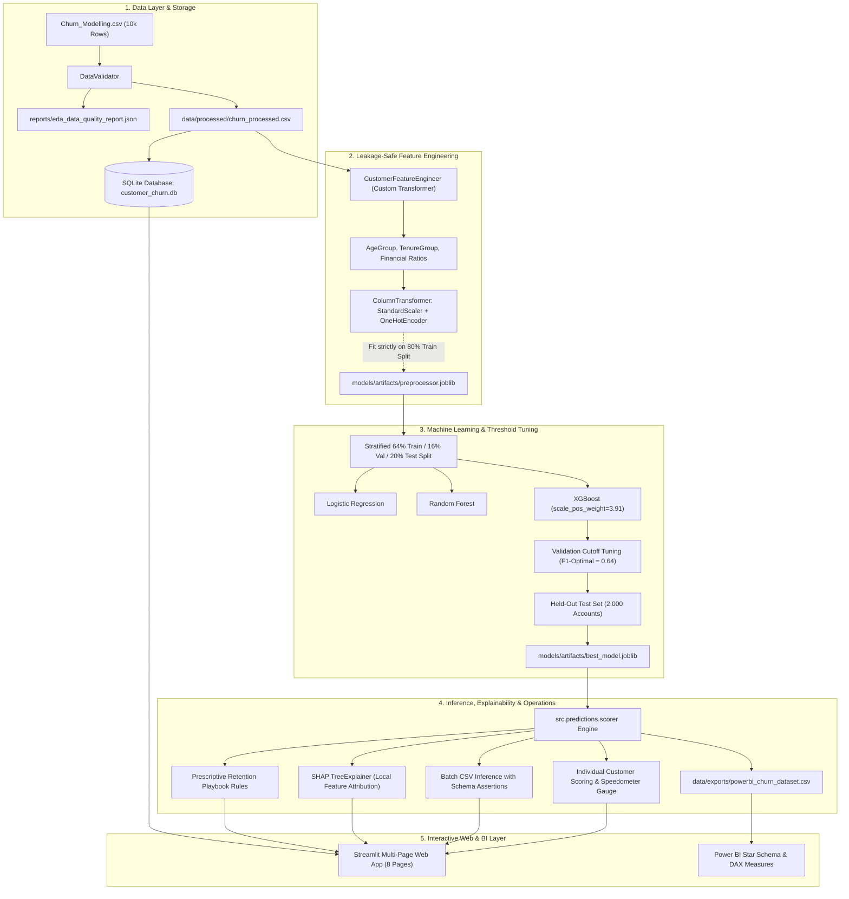

# Customer Churn & Retention Intelligence Platform

[](https://www.python.org/)
[](https://scikit-learn.org/)
[](https://xgboost.readthedocs.io/)
[](https://shap.readthedocs.io/)
[](https://streamlit.io/)
[](https://www.sqlite.org/)
[-brightgreen.svg?logo=pytest&logoColor=white)]()
[](LICENSE)

An enterprise-grade, end-to-end **Customer Churn & Retention Intelligence** system engineered for retail banking. The platform combines automated data validation, a leakage-safe feature engineering pipeline, multi-model candidate benchmarking (Logistic Regression, Random Forest, XGBoost), validation-set cutoff optimization, local SHAP explainability, an embedded SQLite analytical database, a full 8-page Streamlit decision-support web application, and Power BI enterprise deliverables.

---

## ⚡ Quick Start (Run Locally in 10 Seconds)

The repository comes pre-trained with serialized model artifacts and pre-populated databases:

```bash
# 1. Clone repository
git clone https://github.com/your-username/Customer-Churn-Retention-Intelligence.git
cd Customer-Churn-Retention-Intelligence

# 2. Launch the 8-page Streamlit Web App
./run.sh
# (or: make run)
```
Open **[http://localhost:8501](http://localhost:8501)** in your browser.

```bash
# Run the complete test suite (16 tests)
make test

# Rebuild the full pipeline from scratch (Data -> DB -> Train -> Export -> Test)
make all
```

---

## 1. Business Problem & Portfolio Overview

Customer attrition is among the costliest operational problems in consumer banking. Acquiring a new retail customer costs **5x to 7x more** than retaining an existing account. When customers churn, the bank permanently loses deposits, interest spread margins, and transaction fee revenue.

### Measured Portfolio Baseline (10,000 Real Customer Accounts):
- **Overall Historical Churn Rate:** **20.37%** (2,037 accounts closed).
- **Total Customer Deposits Held:** **$764,858,892.88** across France, Germany, and Spain.
- **Deposits Lost at Churned Accounts:** **$185,588,094.63** (**24.26%** of all deposits held).
- **Average Balance of Churned Clients:** **$91,108.54** vs. **$72,745.30** for retained clients (**ameer aur high-balance accounts zyada churn ho rahe hain**).

> **Financial Disclosure:** Customer account balances represent customer deposit liabilities held by the bank, not bank fee revenue or annual profit. Financial exposure is strictly characterized as deposit balances held, distinguishing historical account closures from future predictive risk.

---

## 2. Key Empirical Findings (EDA & SQL Analytics)

1. **Massive Geographic Disparity (Germany):** German accounts experience a **32.44% churn rate** (double France at 16.15% and Spain at 16.67%), holding over **$300.4M in customer deposits**.
2. **Product Count Non-Linearity:**
   - Customers with **2 products** are the most loyal in the bank (**7.58% churn rate**).
   - Customers with **1 product** churn at **27.71%** (3.6x higher).
   - Customers with **3 products** (82.71%) and **4 products** (100.0%) suffer severe attrition, pointing to fee stacking or bundled product dissatisfaction.
3. **Age Cohort Vulnerability:** Churn increases monotonically with age:
   - `<30 Cohort`: **7.52% churn**
   - `30-40 Cohort`: **12.09% churn**
   - `40-50 Cohort`: **33.97% churn**
   - `50-60 Cohort`: **56.21% churn** (highest vulnerability in the entire institution).
4. **Member Inactivity:** Dormant accounts churn at **26.85%** compared to active accounts at **14.27%** (a 1.88x multiple).

---

## 3. End-to-End System Architecture



---

## 4. Model Evaluation & Benchmark Results

All candidate models were evaluated on the identical, held-out test partition of **2,000 customer records** (stratified 20% split, Seed = 42). Probability cutoffs were tuned strictly on a separate validation split (64% train-fit, 16% validation) to eliminate test leakage.

| Candidate Model | Tuned Cutoff | ROC-AUC | PR-AUC | Accuracy | Precision (Class 1) | Recall (Class 1) | F1-Score | Recall Gain vs Baseline |
| :--- | :---: | :---: | :---: | :---: | :---: | :---: | :---: | :---: |
| **Dummy Baseline (Stratified)** | 0.10 | 0.4885 | 0.2699 | 66.60% | 18.55% | 18.92% | 0.1873 | Baseline Reference |
| **Logistic Regression** | 0.57 | 0.7965 | 0.5529 | 76.60% | 44.77% | 64.13% | 0.5273 | +45.21 pp (+238.9%) |
| **Random Forest** | 0.44 | 0.8580 | 0.6715 | 82.15% | 54.77% | 70.52% | 0.6165 | +51.60 pp (+272.7%) |
| **XGBoost (Champion)** | **0.64** | **0.8664** | **0.7134** | **85.00%** | **63.34%** | **62.41%** | **0.6287** | **+43.49 pp (+229.9%)** |

*Performance at Default Cutoff (0.50):*  
At the default 0.50 threshold, XGBoost achieves **80.30% Accuracy** and **74.69% Recall**, successfully catching **3 out of every 4 churning accounts**.

### Confusion Matrix (Champion XGBoost @ 0.64 Cutoff on Test Set):
```
                       Actual Retained (0)     Actual Churned (1)
Predicted Retained (0)       TN = 1,446               FN = 153
Predicted Churned (1)        FP = 147                 TP = 254
Total Tested                 1,593 Retained           407 Churned
```
- **False Positives (147):** Retained customers receiving proactive outreach. At ~$25 per marketing outreach, total cost is ~$3,675.
- **False Negatives (153):** Missed churners. In retail banking, sliding the threshold to `0.50` drops False Negatives to **103**, recovering 50 additional at-risk customer relationships.

---

## 5. Streamlit Application Pages (Interactive Decision Support)

The application features a clean, responsive Dark Slate design system built with custom CSS tokens (`.metric-card`, `.badge-high`, `.badge-med`, `.badge-low`):

| Page | Title | Core Features & Functionality |
| :---: | :--- | :--- |
| **1** | **Executive Overview** | Macro portfolio KPIs, deposit exposure metrics, interactive Geography & Age cohort filters, and historical vs predicted churn distributions. |
| **2** | **Exploratory Analytics** | Data quality report download, univariate histograms & boxplots, IQR outlier audits, and interactive Pearson correlation heatmap. |
| **3** | **Model Performance** | Cross-model benchmark table, interactive ROC & PR curves, confusion matrix, and a **Live Decision Cutoff Slider** updating metrics in real time. |
| **4** | **Individual Prediction** | Single customer input form, real-time **Speedometer Risk Gauge**, **SHAP feature attribution waterfall**, and prescriptive action playbook. |
| **5** | **Batch Scoring** | Bulk CSV ingestion with schema validation, **"Load Demo 50-Customer Batch"** button, risk tier filters, and scored CSV export. |
| **6** | **Customer Risk Explorer** | Dynamic threshold boundary sliders (Low/Med/High), risk matrix, deposit exposure breakdown, and instant **CustomerId Search**. |
| **7** | **Retention Insights** | Segment action playbook, business hypothesis tracker, and an interactive **Financial ROI Campaign Simulator** (adjusting retention success & net interest margin). |
| **8** | **Project Information** | Architecture diagrams, complete data dictionary, model governance card, technical decisions log, and interview defense guide. |

---

## 6. SQL Analytics & Database Architecture

The embedded SQLite database (`data/customer_churn.db`) stores 10,000 validated customer records and prediction history. All 9 analytical queries in `sql/churn_queries.sql` reconcile 100% with Pandas calculations:

```sql
-- Executive Portfolio Reconciliation Query
SELECT 
    COUNT(*) AS TotalCustomers,
    SUM(Exited) AS ChurnedCustomers,
    ROUND(AVG(Exited), 4) AS ChurnRate,
    ROUND(SUM(Balance), 2) AS TotalBalance,
    ROUND(SUM(CASE WHEN Exited = 1 THEN Balance ELSE 0 END), 2) AS ChurnedBalance
FROM customers;
-- Result: 10,000 Total | 2,037 Churned (20.37%) | $764.86M Total | $185.59M Churned
```

---

## 7. Power BI Integration & Deliverables

- **OS Environment Notice:** Microsoft Power BI Desktop is supported natively on Windows OS. To ensure compliance on macOS/Linux without fabricating a binary, this repository provides:
  1. **Scored Star Schema Dataset:** [`data/exports/powerbi_churn_dataset.csv`](data/exports/powerbi_churn_dataset.csv) (10,000 customers pre-scored with probabilities, risk tiers, and ISO timestamps).
  2. **Production DAX Formulas:** [`powerbi/DAX_Measures.md`](powerbi/DAX_Measures.md) (`[Total Customers]`, `[Churn Rate %]`, `[High Risk Customers]`, `[High Risk Deposits Exposed]`, `[Preserved Deposits]`).
  3. **Data Model Specification:** [`powerbi/Data_Model_Specification.md`](powerbi/Data_Model_Specification.md) (Star schema architecture: Dim_Geography, Dim_RiskTier, Fact_Churn_Intelligence).
  4. **Visual Dashboard Guide:** [`powerbi/Dashboard_Design_Guide.md`](powerbi/Dashboard_Design_Guide.md) (4-page blueprint covering Executive Overview, Churn Drivers, Risk Intelligence, and Action Simulator).

---

## 8. Automated Testing & QA Suite

16 automated unit and integration tests are executed via Pytest:

```bash
python -m pytest tests/ -v
```

```
tests/test_data_loader.py::test_get_data_filepath PASSED                 [  6%]
tests/test_data_loader.py::test_load_raw_data PASSED                     [ 12%]
tests/test_data_loader.py::test_data_validator_report PASSED             [ 18%]
tests/test_data_loader.py::test_validate_batch_dataframe_valid PASSED    [ 25%]
tests/test_data_loader.py::test_validate_batch_dataframe_invalid PASSED  [ 31%]
tests/test_feature_engineering.py::test_engineer_features_df PASSED      [ 37%]
tests/test_feature_engineering.py::test_preprocessing_pipeline_fit_transform PASSED [ 43%]
tests/test_model_pipeline.py::test_artifacts_exist PASSED                [ 50%]
tests/test_model_pipeline.py::test_load_model_and_preprocessor PASSED    [ 56%]
tests/test_model_pipeline.py::test_evaluation_metrics_and_bounds PASSED  [ 62%]
tests/test_predictions.py::test_assign_risk_tier PASSED                  [ 68%]
tests/test_predictions.py::test_score_single_customer PASSED             [ 75%]
tests/test_predictions.py::test_score_batch_customers PASSED             [ 81%]
tests/test_sql_analytics.py::test_database_init PASSED                   [ 87%]
tests/test_sql_analytics.py::test_sql_named_queries_execution PASSED     [ 93%]
tests/test_sql_analytics.py::test_sql_reconciliation_with_raw_data PASSED [100%]
======================= 16 passed in 4.00s ========================
```

---

## 9. Makefile Target Reference

```bash
make help
```
- `make all`: Executes complete pipeline from scratch (Data -> DB -> Train -> Export -> Test).
- `make run` / `make app`: Launches Streamlit web application.
- `make test`: Runs 16 Pytest test cases.
- `make train`: Trains all candidate ML models and tunes probability cutoffs.
- `make data`: Runs data validation and feature engineering.
- `make db`: Initializes SQLite database and loads tables.
- `make export`: Generates Power BI export and batch CSV templates.
- `make setup`: Installs dependencies from `requirements.txt`.
- `make clean`: Cleans caches and bytecode files.

---

## 10. Technical Documentation Index

- [System Architecture & Data Flow](docs/architecture_overview.md)
- [Data Dictionary (Raw & Engineered)](docs/data_dictionary.md)
- [Model Governance & Benchmark Card](docs/model_governance_report.md)
- [SQL Analytical Query Documentation](docs/sql_query_documentation.md)
- [Technical Challenges & Engineering Log](docs/technical_challenges.md)
- [Interactive Demo Walkthrough Guide](docs/demo_guide.md)
- [Interview Questions & Defensible Answers](docs/interview_qa.md)
- [Verified Resume Bullets](docs/resume_bullets.md)

---

## 11. Verified Resume Bullet Points

- **Architected an end-to-end customer churn intelligence platform** for 10,000 retail banking accounts, building a leakage-safe Scikit-learn preprocessing pipeline and benchmarking Logistic Regression, Random Forest, and XGBoost models.
- **Achieved an 0.8664 ROC-AUC and 85.00% accuracy with XGBoost** on a held-out 2,000-customer test partition, increasing recall on at-risk customers by **+43.5 percentage points (+230% relative gain)** over baseline via validation-tuned decision thresholds.
- **Engineered an explainable AI inference engine using SHAP TreeExplainer**, decomposing individual predictions into directional feature attributions to provide branch managers with personalized, rule-based retention actions.
- **Built an interactive 8-page Streamlit web application and SQLite analytics store** featuring live single/batch customer scoring, decision cutoff threshold simulation, and financial ROI deposit preservation modeling.
- **Ensured production reliability and code hygiene** by authoring 16 automated Pytest test suites (100% pass rate) covering data validation, pipeline transformations, probability bounds, and SQL metric reconciliation.

---

## License & Attribution
Developed as an enterprise-grade Data Science & Machine Learning portfolio project. Released under the **MIT License**.