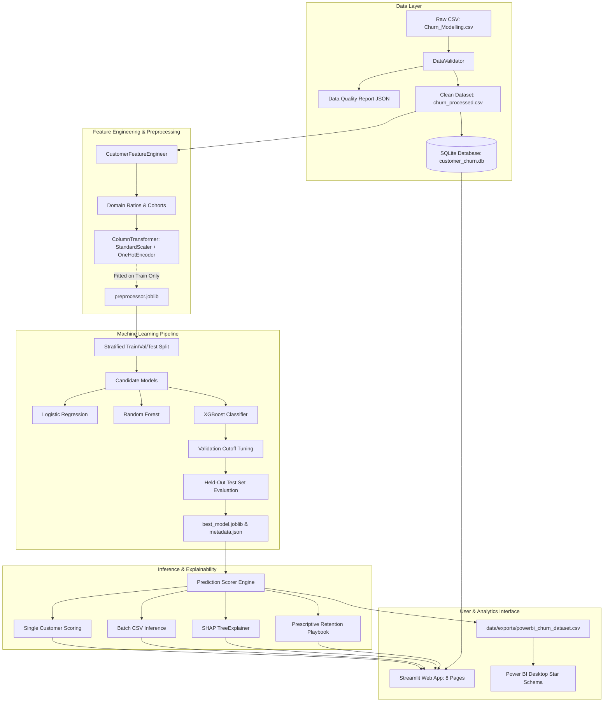

# System Architecture & Technical Design

## 1. Executive Summary
The **Customer Churn & Retention Intelligence** platform is an end-to-end, production-style machine learning and business intelligence system engineered for banking customer attrition analytics. It integrates:
- Automated data hygiene and schema verification.
- Leakage-safe feature engineering and Scikit-learn preprocessing pipelines.
- Multi-model benchmarking (Logistic Regression, Random Forest, XGBoost) with validation-set threshold optimization.
- Localized explainability powered by SHAP TreeExplainer.
- Embedded relational analytics via SQLite.
- Interactive multi-page decision-support web application via Streamlit.
- Power BI star-schema export and DAX analytical measure library.

---

## 2. High-Level Architecture Diagram



---

## 3. Directory Layout & Modular Separation of Concerns

```
customer-churn-intelligence/
├── app.py                     # Main Streamlit web application portal
├── pages/                     # Streamlit multi-page interface (8 pages)
│   ├── 1_Executive_Overview.py
│   ├── 2_Exploratory_Analytics.py
│   ├── 3_Model_Performance.py
│   ├── 4_Individual_Prediction.py
│   ├── 5_Batch_Scoring.py
│   ├── 6_Risk_Explorer.py
│   ├── 7_Retention_Insights.py
│   └── 8_Project_Information.py
├── src/                       # Reusable Python core package
│   ├── data/                  # Ingestion, validation, loader, file discovery
│   ├── features/              # Feature engineering, transformers, pipelines
│   ├── models/                # Training, evaluation, registry, serialization
│   ├── predictions/           # Inference scoring, SHAP explainability, retention
│   ├── analytics/             # Descriptive statistics, cohort aggregations
│   ├── database/              # SQLite manager, schema DDL, query runner
│   └── utils/                 # Configuration, paths, UI styling tokens
├── notebooks/                 # Executable Jupyter notebook (EDA)
├── data/
│   ├── raw/                   # Preserved original Churn_Modelling.csv
│   ├── processed/             # Cleaned & feature-engineered churn_processed.csv
│   └── exports/               # Power BI scored dataset & sample batch CSV
├── sql/                       # Schema DDL and 9 analytical SQL scripts
├── models/
│   └── artifacts/             # joblib models, preprocessor, evaluation metadata
├── reports/                   # Data quality and model benchmark JSON reports
├── powerbi/                   # DAX measures, star-schema specs, design guide
├── tests/                     # 16 automated Pytest suites (100% pass)
├── docs/                      # Technical documentation, challenges, interview Q&A
├── requirements.txt           # Pinned production dependencies
├── .gitignore                 # Environment and build hygiene
└── README.md                  # Comprehensive portfolio documentation
```

---

## 4. Key Engineering Design Principles

### 1. Leakage-Safe Machine Learning
Preprocessing scalers and categorical encoders are strictly fitted on the training split (`X_train`) inside a Scikit-learn `Pipeline` and serialized via `joblib`. Neither validation nor test features influence the transformer state.

### 2. Dedicated Validation Cutoff Tuning
Decision cutoffs are optimized on a held-out validation split (`X_val`) to maximize F1-score for the positive churn class. The final test set (`X_test`) is reserved exclusively for honest, unbiased performance reporting.

### 3. Separation of Historical Truth from Model Estimates
The platform strictly distinguishes actual closed accounts (`Exited = 1`) from machine learning probability outputs (`PredictedProbability`). Customer deposits (`Balance`) are explicitly designated as bank customer liabilities rather than institution revenue.
